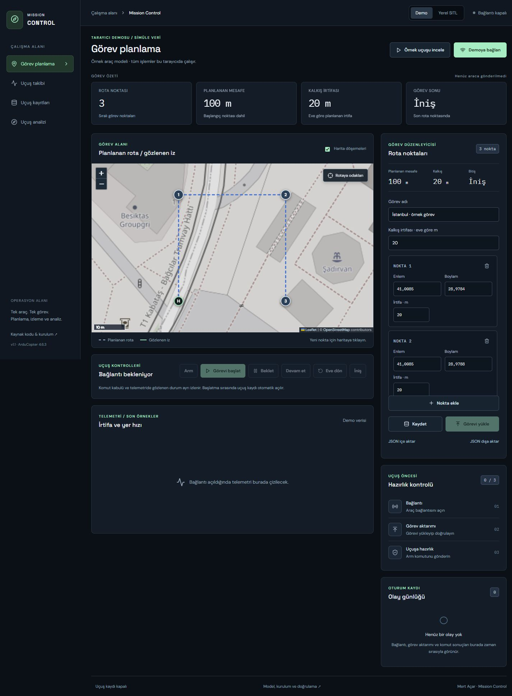

# Mission Control

Plan a mission, fly one virtual UAV, watch telemetry, record the flight, replay it and export a report.

**[Browser demo](https://mertacar-git.github.io/mission-control/)** · **[Portfolio](https://mertacar-git.github.io/portfolio/)** · [Verification evidence](docs/verification/README.md)

React + TypeScript + Leaflet + Recharts frontend, FastAPI + SQLite backend, and an app-owned ArduCopter SITL process speaking MAVLink. The interface is Turkish; code and documentation are English.



[Watch the walkthrough video](https://github.com/mertacar-git/mission-control/raw/refs/heads/main/docs/media/walkthrough.mp4) — captured SITL replay views and report.


## Operator workspace · UI 1.1

The interface uses a map-first workspace with a focused coordinate editor, route distance and explicit preflight readiness. Disconnected planning displays **planned** values; connected operation displays **measured** telemetry. An unavailable reading is never replaced by a planned value. Mission stages account for the different SITL/browser mission indices and never declare successful completion from a disarmed heartbeat alone.

Flight archives support name search and demo/SITL source filtering. Playback shows command and vehicle events without flooding the visible log with telemetry rows; the complete telemetry still remains in the recording. Repeated start actions are disabled while AUTO is observed. Map controls include metric scale and route fitting, including grid-only mode.

Presentation code is separated into editor, archive, readiness, event-log and chart components. The chart library loads on demand; the initial JavaScript bundle is about 355 kB (110 kB gzip), with a separate chart chunk. Frontend verification includes 22 tests, TypeScript compilation and browser checks of planning, controls, archive filters and isolated replay.

## Two distinct modes

The public GitHub Pages **Demo** runs entirely in your browser with a deterministic kinematic vehicle model. It does **not** connect to MAVLink, a backend or a physical aircraft. Missions and demo recordings use local browser storage. An example recording is available immediately.

**Local SITL** runs the real ArduCopter software in Ubuntu/WSL. The backend starts and controls only its own process, using a fixed loopback endpoint. There is no physical-aircraft connection setting. Demo results are not evidence of autopilot behavior. Real SITL acceptance results are saved separately in `docs/verification`.

## Local installation: Windows + Ubuntu WSL

Requirements: Ubuntu 24.04 / Python 3.12 inside WSL, Git, Node.js 22 and npm on Windows. The firmware build needs several GB of disk space and network access. Keep ports UDP 14550, HTTP 8000 and development HTTP 5173 free.

Clone this repository in Windows, then open an Ubuntu terminal at its WSL path:

```bash
git clone https://github.com/mertacar-git/mission-control.git
cd mission-control
# In Ubuntu/WSL, at the same checkout:
sudo bash simulator/setup.sh
bash simulator/setup.sh
bash simulator/run-backend.sh
```

The first setup invocation installs Ubuntu build dependencies. The second builds firmware as the normal user. Runtime files live in `/opt/mission-control`; the source checkout remains separate. The launcher pins **Copter-4.6.3**, commit `92b0cd788ec29406f26c6f9c31d5ceedbd1cc538`, and rejects another revision. SITL is launched on demand by the UI; do not start a second simulator manually on the same port.

In a Windows terminal at the repository:

```powershell
cd frontend
npm ci
npm run dev
```

Open **http://127.0.0.1:5173**, select **Yerel SITL**, then **SITL başlat & bağlan**. Wait until heartbeat, position and EKF navigation are ready. Save/upload the mission, arm, then start it. Startup estimator initialization can take around a minute. Pre-arm rejections are shown in the event log; wait for readiness and explicitly try again. Start/takeoff commands are never automatically retried.

Mission altitudes are **metres relative to home**, not MSL. The example home is an arbitrary simulation location near Istanbul (`41.0082, 28.9784`, MSL 30 m), not the user's location. A mission contains takeoff, ordered waypoints and landing. ArduPilot's internal home item occupies index 0, followed by takeoff at index 1; UI mission indices are autopilot indices.

To serve the built frontend from the backend instead of Vite:

```powershell
cd frontend
npm run build
```

Leave the WSL backend running and open **http://127.0.0.1:8000**. The local frontend uses same-origin HTTP/WebSocket; the Vite development server proxies `/api` and `/ws`. GitHub Pages intentionally does not reach a local backend.

## Workflow

1. Edit coordinates numerically or add/drag route points on the map. Save missions or import/export mission JSON.
2. Connect, upload and read back the full mission. Editing and upload are locked while armed.
3. Arm and start. Recording opens automatically on start; stop/save it after landing. Hold uses LOITER, resume uses AUTO, return uses RTL, and landing uses LAND.
4. Open **Uçuş kayıtları** and select **Oynat**. Pause, seek and select 0.5×/1×/2×. All live command controls are disabled during replay. Replay does not stop a live vehicle running in the background.
5. Select **Analiz** for altitude/speed charts, battery change, threshold alerts, observed distance and planned-route deviation. Export versioned JSON or CSV.

Map tiles can be disabled; coordinates, route geometry and vehicle markers continue working. Repeated tile errors automatically switch to the grid background. Tile requests go to OpenStreetMap with visible attribution. External fonts have system fallbacks.

## Data and command semantics

- One MAVLink reader distributes messages to command/mission waiters and WebSocket subscribers. Telemetry snapshots are published every 0.5 seconds.
- Missing measurements remain `null`; CSV cells remain empty. Old position/speed measurements expire after 3 seconds and battery measurements after 5 seconds.
- Heartbeat silence: **stale at 3 seconds**, **disconnected at 10 seconds**. New commands require current telemetry and an owned running simulator.
- Commands have separate requested, acknowledged, observed, failed and timed-out events. An accepted acknowledgment does not prove takeoff or landing completed. Observation means the requested armed state or flight mode was seen; mission completion is inferred separately from telemetry and mission progress. Unobserved acknowledged transitions expire after 15 seconds.
- One browser control lease lasts 15 seconds and renews every 2.5 seconds. One command or mission transfer runs at a time. Other controllers receive a conflict/permission error.
- Mission upload uses MAVLink COUNT → REQUEST[_INT] → ITEM_INT → ACK and then REQUEST_LIST/COUNT/readback verification. Duplicate requests are idempotent; transfer retries are bounded. Command sends are not retried automatically.
- SQLite preserves telemetry, command results, mission progress and connection changes. Live subscriber queues are bounded; dropped live events are detectable by sequence numbers and do not delete the persisted recording.
- `received_utc` is backend reception time; `vehicle_time_ms` is autopilot boot time; `elapsed_s` is backend monotonic wall time. SITL integration tests run at 4×. Duration/distance gaps and frontend replay use reception time, not speed-corrected flight time. Battery percentages are simulator measurements, not an energy consumption model.
- Distance excludes stale positions and intervals longer than 3 seconds. Route deviation is horizontal distance to the user waypoint polyline, excluding the home-to-first-point leg. Unknown metrics remain null. Alerts count threshold-exceeding samples, not distinct episodes.

See [API contract](docs/API.md) for endpoints and examples.

## Tests

```bash
# Ubuntu, from backend/
/opt/mission-control/venv/bin/pip install -r requirements.txt
/opt/mission-control/venv/bin/python -m pytest -q
/opt/mission-control/venv/bin/python -m tests.integration_runner
```

```powershell
# Windows, from frontend/
npm test
npm run build
```

The integration runner requires real installed SITL and exclusive UDP 14550 ownership. It tests readback, rejected commands, a complete takeoff/route/landing recording and report, heartbeat loss/recovery/reconnect, hold/resume/RTL, and configured low-battery RTL/landing. It exits unsuccessfully on any failed scenario. Unit tests use protocol doubles; they do not replace SITL acceptance.

GitHub Actions runs backend/frontend tests and the production build before publishing Pages. A separate **Real SITL acceptance** workflow performs a clean Ubuntu firmware setup and the real scenarios on manual dispatch.

## Scope and license

One virtual quadcopter, one control session, local backend. Multi-vehicle operations, hardware, ROS 2, PX4 and cloud deployment are outside this release. This is a portfolio simulation application, not flight-certified software.

Application source: [MIT](LICENSE). ArduPilot is downloaded separately and remains under its own GPL license; firmware is not vendored. Leaflet/OpenStreetMap and other dependencies retain their own licenses. Developed with AI assistance, with executable tests and recorded verification evidence for review.
