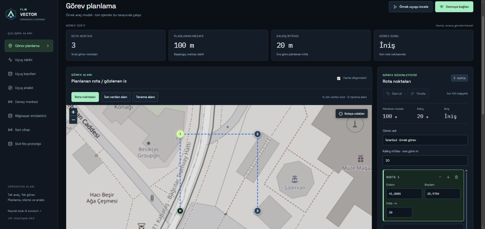

# Civilian fleet workflow prototype

## Delivered scope

The simulation section of **Sivil filo prototipi** is a browser-only, explicitly synthetic workflow
prototype with three civilian sample devices assigned to two sample stations.
The device catalogue carries serial, model, firmware and camera/sensor identifiers.
There is no network adapter, remote computer, real identity provider or aircraft
control integration. Choosing a role is a simulation control, not authentication.
The separate authenticated equipment registry panel below it uses a local service;
see [registry setup and actual software transport acceptance](FLEET_REGISTRY.md).

Station A can create requests for its two devices; station B has its own device.
The center simulation role reviews requests with a mandatory reason. A request
or approved window expires 120 seconds after creation. A disconnected station,
missing/stale observation or incompatible observed state prevents approval.
Rejection remains possible without fresh measurements. Only the requesting
station or center can cancel an open request in the simulation model.

Approval never changes the observed state. A separate station simulation selector
generates grounded/airborne/landing observations; it does not send a flight command.
The timeline therefore distinguishes request, decision, cancellation and observation.
These administrative examples do not constitute official airspace authorization.

Station feeds refresh every 500 ms while enabled. After 3 seconds measurements
are stale; after 10 seconds they are disconnected. Old battery and observation
values are not presented as current. The last receive age remains visible.
All quantities and device identities are synthetic.

## Use

1. Open **Sivil filo prototipi** and leave the role at **İstasyon A**.
2. Request takeoff review for SIM-FLW-0001.
3. Switch to **Merkez**, enter a reason and approve. The device remains grounded.
4. Switch back to **İstasyon A** and change the separate sample observation.
5. Stop station A's feed: station B remains current, while A's devices become unknown.
6. Export the JSON simulation report. It includes synthetic source, timestamps,
   computed effective permission states and retention limits.

The current session is memory-only and resets when the page is left or refreshed.
The model retains at most 100 requests and 500 events; these are not durable audit
records or production authorization. No import path exists for approving an
external permission document. Existing SITL, serial and recorded flight paths
remain separate from this workflow.

## Next implementation boundary

Before remote stations are connected, extend the local authenticated registry with
production station/device enrolment and credential lifecycle, TLS deployment and
operator accounts. Server-side permission processing is not implemented.
Hosting topology (LAN, VPN or
Internet) determines certificates and deployment requirements. Browser role
selection must never authorize a real station or device.

The first distributed acceptance target is three **synthetic** device publishers,
two station processes and one center; no physical aircraft control or weapons
integration is part of this module. Physical-device enrolment requires separate
acceptance. The current page demonstrates workflow requirements; it does not
claim that distributed acceptance has already passed.

The selected next topology supports both LAN and Internet stations. Use one
versioned center API contract with deployment-specific endpoints. Internet
deployment requires HTTPS and server-side station/operator identities; LAN mode
must not weaken role or device ownership checks. Actual hosting endpoints and
credentials will be configured at deployment, not embedded in the Pages bundle.

## Verification

The required software suite passed 108 backend tests, 84 frontend tests and
16 desktop/mobile browser cases. Six model tests cover ownership rules in the
simulation, duplicate requests, mandatory reasons, expiry boundaries, station
loss, state compatibility and cancellation. The browser case verifies that
approval leaves a device grounded until a separate observation changes it.
These tests validate the browser prototype, not remote authentication or aircraft.

