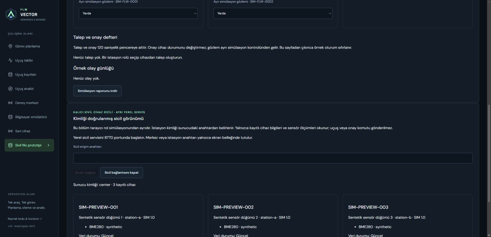

# Civilian equipment registry — local distributed foundation

Proposed security requirements are documented separately in the
[FLW policy](FLW_CRYPTO_POLICY.md) and [FSL draft](FSL_V1.md). The current service
does not implement those TLS/session/key-lifecycle requirements.

This service persists device metadata, received sensor reports and audit events
in its own SQLite database. It never opens the SITL/serial stores, sends flight
commands, approves operations or controls an aircraft. The browser's synthetic
permission workflow remains a separate demonstration.

## Start locally

From `backend`, using the existing Python environment:

```powershell
python -m mission_control.fleet_service --init
python -m mission_control.fleet_service
```

The first command exclusively creates `.runtime/fleet/credentials.json` plus
separate `center.token`, `station-a.token` and `station-b.token` files. No secrets
are printed or committed. Keep the directory private to the intended Windows
user; POSIX files receive mode 0600. Give a station only its own token file, never
the combined server configuration or center token. Rotation currently requires
updating private configuration and restarting; online enrolment/rotation is not
implemented.

The service binds only to **127.0.0.1:8770**. In the locally running FLW VECTOR,
open **Sivil filo prototipi**, scroll to **Kimliği doğrulanmış sicil görünümü** and
enter a center or station token. The token stays in UI memory. Public Pages does
not connect to this service. The authenticated viewer only reads the registry.

## Enrol sample equipment

Only the center credential can POST `/api/v1/fleet/devices`. Example PowerShell,
run from `backend`; secrets are read from private files, not embedded in commands:

```powershell
$registryKey = (Get-Content -Raw .runtime/fleet/center.token).Trim()
$registryHeaders = @{ Authorization = "Bearer $registryKey" }
$sampleDevices = @(
  @{serial='SIM-001';name='Bench node 01';model='Civilian sensor prototype';station='station-a';firmware='SIM 1';equipment=@('BME280')},
  @{serial='SIM-002';name='Bench node 02';model='Civilian sensor prototype';station='station-a';firmware='SIM 1';equipment=@('Temperature sensor')},
  @{serial='SIM-003';name='Bench node 03';model='Civilian sensor prototype';station='station-b';firmware='SIM 1';equipment=@('BME280')}
)
foreach ($entry in $sampleDevices) {
  Invoke-RestMethod -Uri http://127.0.0.1:8770/api/v1/fleet/devices -Method Post -Headers $registryHeaders -ContentType application/json -Body ($entry | ConvertTo-Json)
}
```

Start these commands in two separate terminals:

```powershell
python -m mission_control.fleet_station --token-file .runtime/fleet/station-a.token --seconds 30
python -m mission_control.fleet_station --token-file .runtime/fleet/station-b.token --seconds 30
```

They publish explicitly synthetic environmental measurements. Battery is unknown.
The bounded duration is 1–60 seconds. CLI boot IDs default to wall-clock seconds;
the synthetic publisher is not a durable physical-device boot counter. A repeated
boot/sequence may be rejected; use a newer explicit `--boot` for a new test run.

## Contract and guarantees

| Endpoint | Authority |
|---|---|
| `GET /api/v1/fleet/snapshot` | Center sees all devices; a station sees only its own |
| `POST /api/v1/fleet/devices` | Center enrols a unique serial/model/firmware/equipment record |
| `POST /api/v1/fleet/devices/{serial}/measurements` | Only the assigned station publishes reports |
| `GET /api/v1/fleet/audit` | Center reads the last 500 durable audit events |

Server identity comes from distinct bearer credentials, not a browser-selected
role. Reports contain source (`synthetic` or station-reported `serial`), uint32
boot/sequence, uint64 source uptime, and nullable battery/temperature/pressure/
humidity measurements. The reported origin is not proof of physical calibration.
Extra fields, including flight commands, are rejected. There is no command route.

Freshness uses server monotonic receipt time: less than 3 seconds is fresh;
3–10 seconds is stale; at 10 seconds it is disconnected. Stale measurements are
not returned as current. After a restart, persisted reports have unknown freshness
until a new accepted report arrives. Old boot IDs, duplicate sequences and clock
regression within a boot are rejected. Large source clocks serialize without JS
rounding. Source and server clocks are independent; no one-way latency is inferred.

SQLite schema version 1 and audit records persist across restart. Current enrolment
is create-only; device transfer, deletion, credential lifecycle, operator accounts,
retention policy and production provisioning remain subsequent work.

## LAN and Internet next stage

Both requested environments will use the same contract. The current verified
deployment is loopback only. Non-loopback publishers require verified HTTPS and
refuse redirects so credentials are not forwarded to another origin. LAN/Internet
TLS termination, allowed host/origin configuration, rate limiting and account
management still require a deployment phase; this service is not publicly exposed.
Do not distribute the center's private configuration to station computers.

The automated transport test launches two separate publisher processes against
an actual loopback HTTP server and checks three enrolled devices. It validates
software transport and scopes, not physical equipment or an Internet deployment.

Software acceptance passed 113 backend tests, 84 frontend tests and 18 browser
cases. A transaction-failure test verifies that failed durable writes cannot
refresh a measurement. Browser tests verify memory-only credentials and removal
of current readings when the registry is unavailable. Manual Opera inspection
also connected the UI to a temporary local service with three synthetic nodes.
Current audit endpoints cover successful enrolment/report writes; production
authentication monitoring and retention management are not yet implemented.


