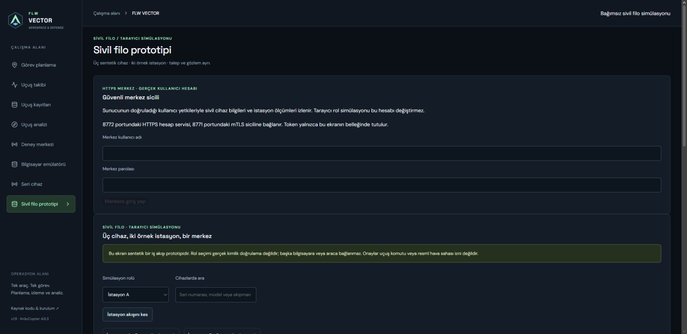

# Human accounts and HTTPS center gateway

19 October 2026. Civilian metadata/sensor registry only. Local software foundation,
not two-PC deployment or an aircraft-control authorization system.

## Start

Install backend requirements, create a TLS laboratory using the FSL setup, and
start the registry at loopback HTTPS 8771. From `backend`, bootstrap separately:

```sh
python -m mission_control.operator_accounts --directory .runtime/operators --bootstrap --username admin
python -m mission_control.operator_accounts --directory .runtime/operators --tls-directory .runtime/fsl-center
```

Bootstrap prompts for a 15–128 character password without echo. There is no
password command-line flag or checked-in credential. Existing directories are
never overwritten. The human service binds only `127.0.0.1:8772`, requires TLS 1.3
and does not require the human browser to possess a station private key.
The browser must trust the intended local test server through a properly configured
test profile/CA; do not bypass certificate warnings or weaken verification.
Browser-profile trust provisioning is a deployment step, not performed automatically.

Open the local application, then **Sivil filo prototipi → Güvenli merkez sicili**.
Enter the created human account. Public Pages displays an explanatory notice and
never attempts a local account connection. The session token is kept in component
memory, not local/session storage. Password state clears after an attempted login.
Leaving the screen clears client state; it does not silently claim server logout.
Explicit logout revokes the server session. A failed logout is reported, and the
remaining server session expires within its original 15-minute lifetime.

## Permissions and gateway

| Action | Admin | Operator |
|---|---|---|
| Read own identity / logout | Yes | Yes |
| Read civilian device/sensor registry | Yes | Yes |
| Create human accounts / disable another account | Yes | No |
| Inspect human security audit | Yes | No |
| Enroll device metadata through operator gateway | Yes | No |
| Publish station measurements or issue flight commands | No | No |

Endpoints: `/api/v1/operators/login`, `/me`, `/logout`, `/users`,
`/users/{username}/disable`, `/password`, `/audit`, `/registry`, `/devices`.
Administrators can list/create users, review account disable and read security
events from the center UI. Operators can read the registry and change their own
password; the admin section is absent for them and the API also enforces that role.
Disabling a user deletes its active sessions and also checks enabled state on every
request. Roles are returned by the backend; browser simulation role selection has
no effect on a human account. Self-disable is rejected. Password change requires
the current password, rejects reuse, is limited after five failures in 300 seconds
and atomically revokes every session for that account. A storage/audit failure
rolls back password and session changes together. Offline recovery is available
to the OS administrator with access to the account database; MFA and an external
identity provider are not implemented.

For a forgotten password, stop the local operator service, then run:

```sh
python -m mission_control.operator_accounts --directory .runtime/operators --recover admin
```

The command prompts twice without echo. It only resets an existing enabled user,
preserves the role, revokes all sessions, clears login/password-change failure
counters and records `password.recovered` under `offline-recovery`. It never
creates a missing database/user or re-enables a disabled account. Restart the
service and sign in explicitly. Protect OS file access: this is offline database
administration, not an unauthenticated HTTP recovery endpoint.

The gateway authenticates downstream using its center certificate against the
fixed loopback HTTPS registry, checks the human role before metadata mutation,
and refuses redirects and non-loopback/plaintext targets. The center private key
stays at the gateway; no station/private key or downstream credential reaches the
browser. Local CORS permits only the existing localhost/127.0.0.1 UI ports.
An unavailable/revoked registry produces an error with no current measurements.
The UI polls only reads; it never automatically retries writes or flight commands.
Between responses, displayed measurement age advances using the browser's
monotonic elapsed time plus the server-reported sample age. At three seconds
fresh readings are hidden as stale, including while a request is stalled. Request
failure clears the snapshot. This does not calculate network latency or prove a
compromised station's sample time.

Legacy HTTP/mTLS APIs, offline CA tools and SITL controller leases keep their own
authorization boundaries. This account service does not redefine those privileges.
Restrict access to center files separately; a compromised OS user can bypass
application roles by accessing private files. Real-PC Windows ACL checks remain pending.

## Storage and limits

Separate additive account SQLite schema version 1. Passwords are salted scrypt
hashes (`N=131072,r=8,p=1`, 16-byte random salt, 32-byte output). This uses Python's
standard library, with no custom password cipher. Sessions are random tokens;
only SHA-256 token digests are persisted. Tokens last 900 seconds, at most eight
per account; clock regression before issuance fails authentication. KDF work is
serialized to limit concurrent memory demand in the single-worker local service.

Five denied attempts per username in a 300-second window temporarily block login.
The counter survives restart; a maximum of 1,000 unexpired failure rows and 100
accounts bounds this local profile. Unknown and disabled users receive the same
credential error. Login, logout, user creation/disable and role denials are audited
without passwords/tokens; validation errors do not echo submitted passwords.
The last 500 audit rows can be read; durable retention/rotation remains pending.
SQLite encryption and disaster recovery are not implemented by password hashing.

Device enrollment logs durable intent before calling the other service and logs
acceptance afterward. A downstream/second-write failure can leave uncertain outcome;
there is no cross-service atomic transaction or automatic retry. Reconcile against
the registry's own device/audit state. No production audit immutability claim is made.

Verification: role bypass denial, disable/logout, restart/expiry, persistent login
limits, secret-redacted errors, real human HTTPS socket login, real mTLS gateway
and revoked-center denial. Browser tests cover desktop/mobile login, token storage
isolation, password cleanup and expiry clearing. Mocked UI tests do not establish
browser CA trust or real two-computer acceptance.

Next: identity-action audit, separate-PC outage/recovery cases,
station-local credential deployment and two-PC LAN acceptance. See
[ordered delivery plan](CENTER_DELIVERY_PLAN.md).

Password profile reference: [OWASP password storage guidance](https://cheatsheetseries.owasp.org/cheatsheets/Password_Storage_Cheat_Sheet.html).


