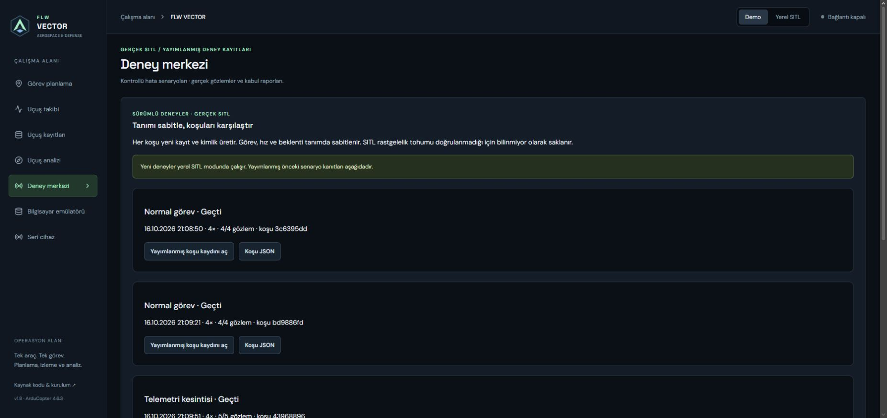
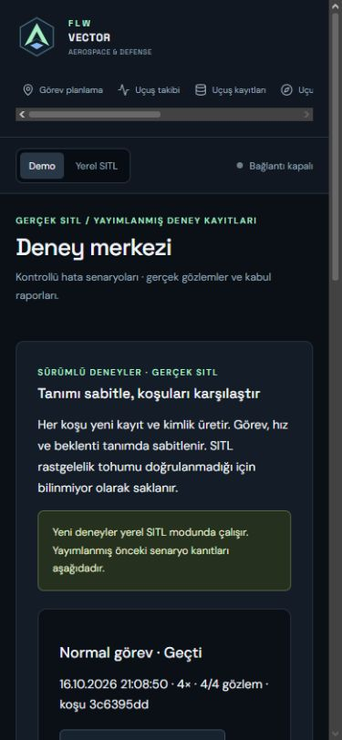

# FLW VECTOR — operator workflow refresh

17 October 2026. UI update on the v1.8 runtime and data contracts.

## Working flow

Open **Deney merkezi**. In local mode, create an immutable experiment definition
from the mission draft, then open that definition and start a new run. Close the
existing vehicle connection and recording first. Replay remains isolated from
live commands. Each run preserves its own identity and results.

Previous scenario records remain accessible in the collapsed legacy archive.
They cannot create new experiments from that panel. Historical API routes remain
compatible; linked experiment runs are excluded from the legacy list.

If the experiment history cannot be retrieved, mutation controls are disabled.
Last received results remain visible during a polling failure. Retry fetches a
fresh snapshot; it never resends a flight command. New definitions require an
integer timeout of 90–600 seconds. Recording search also matches the recording
ID; comparison selectors show timestamps and short IDs to distinguish equal names.

## Verification and scope

The required software acceptance suite passed in Ubuntu: 103 backend tests,
76 frontend tests and 12 browser checks across desktop and 390 px mobile, plus
HTTP/WebSocket, serial PTY and independent UDP-process checks. The new browser
case verifies that an unavailable experiment service blocks mutations and that
retry recovers without posting a command. Portfolio migration has two passing tests.

The Windows Playwright attempt could not launch because its Chromium executable
was not installed; the completed Ubuntu browser suite supplies acceptance evidence.
Manual Opera inspection verified the new identity and mobile layout (390 px
viewport, 375 px document width).

This delivery changes branding and operator UI, not flight behavior. The previous
v1.8 SITL evidence remains historical acceptance, not a newly run flight campaign.
Physical USB board, sensor calibration and physical accuracy remain pending.

