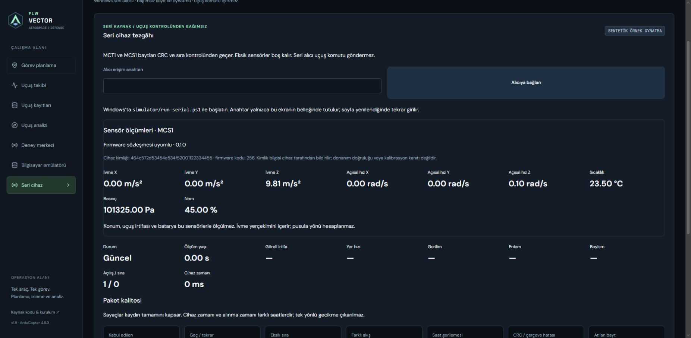

# Sensor node integration — MCS1 v1

The ESP32 prototype adds a sensor-only companion protocol. MCT1 v1 remains
unchanged; old raw JSONL recordings remain readable. Both packet types use the
same existing serial archive, but never enter flight telemetry or flight stores.

## Wire contract

MCS1 is exactly **82 bytes**, little endian. CRC-32/ISO-HDLC covers bytes 0–77;
bytes 78–81 carry the CRC, matching Python zlib. Floats are IEEE binary32.

| Offset | Bytes | Meaning |
|---|---:|---|
| 0 | 4 | `MCS1` magic |
| 4 | 1 | Protocol version, exactly 1 |
| 5 | 1 | Validity bits: 0 all six IMU values; 1 temperature; 2 pressure; 3 humidity; upper bits zero |
| 6 | 16 | Reported device identity |
| 22 | 4 | Persistent boot counter |
| 26 | 4 | Sequence |
| 30 | 8 | Source uptime in ms |
| 38 | 4 | Firmware code: major<<16, minor<<8, patch |
| 42 | 12 | Acceleration X/Y/Z in m/s², including gravity |
| 54 | 12 | Angular velocity X/Y/Z in rad/s |
| 66 | 4 | BME280 temperature in °C |
| 70 | 4 | Pressure in Pa |
| 74 | 4 | Relative humidity in percent |
| 78 | 4 | CRC |

Cleared validity bits produce null values, regardless of placeholder bytes.
Valid values must be finite and bounded: acceleration ±200 m/s², angular velocity
±40 rad/s, temperature −40–85°C, pressure 30,000–110,000 Pa, humidity 0–100%.
These are decoder plausibility bounds, not sensor accuracy claims. Unknown
protocol versions/reserved flags fail framing; unknown firmware codes remain
inspectable with an explicit compatibility warning.

Frames retain the existing stream/boot/sequence/clock tracking and three-second
freshness limit. Source and receipt clocks are separate; no one-way latency is
calculated. Unmeasured flight fields remain null. No calibration, heading or
barometric flight-altitude conversion is applied.

## Try without hardware

Open **Seri cihaz → Sentetik sensör sözleşmesi örneğini aç**. The public sample
contains an IMU gap and a CRC-corrupt packet, followed by stale data. It is
explicitly synthetic. Raw JSONL import/export and replay use the same decoder.

Generate another sample (exclusive creation prevents overwriting an archive):

```bash
cd backend
python -m mission_control.sensor_sample --output sample.jsonl
```

[Firmware, wiring and physical acceptance](../prototype/esp32/README.md).
[Shared Python/C++/TypeScript vector](../prototype/sensor-vector.json).

Software verification checks fragmented serial framing, CRC rejection, missing
sensor groups, raw replay and uint64 clock preservation. Physical USB/board
operation and calibration remain pending until the purchased hardware arrives.

The v1.9 software suite passed 108 backend tests, 78 frontend tests and 14 browser
cases (desktop and 390 px). A real Linux PTY exercised fragmented MCS1 capture;
Python/C++/TypeScript share packet evidence. Firmware compilation is a separate
mandatory CI job and gates public deployment. It does not certify physical sensors.


